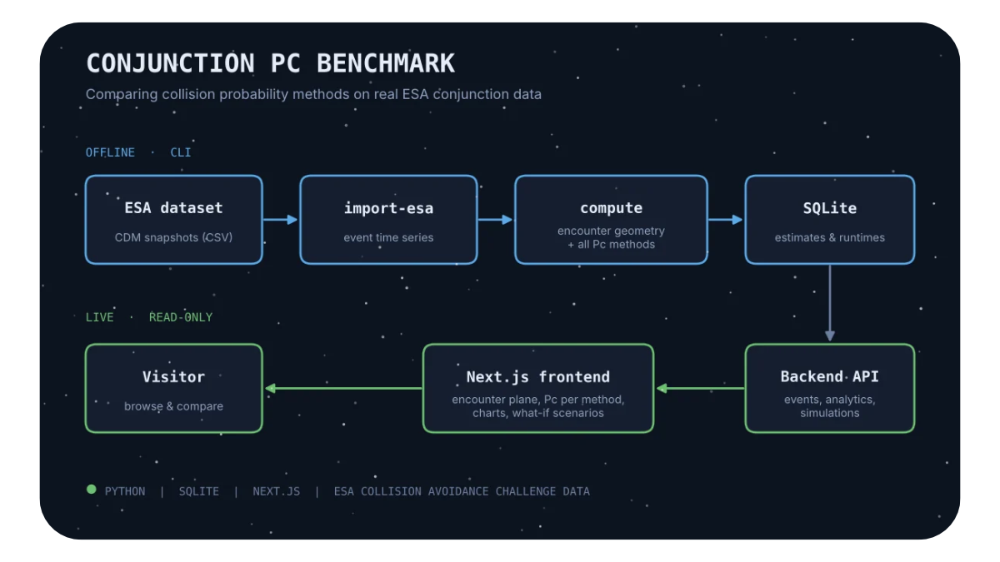
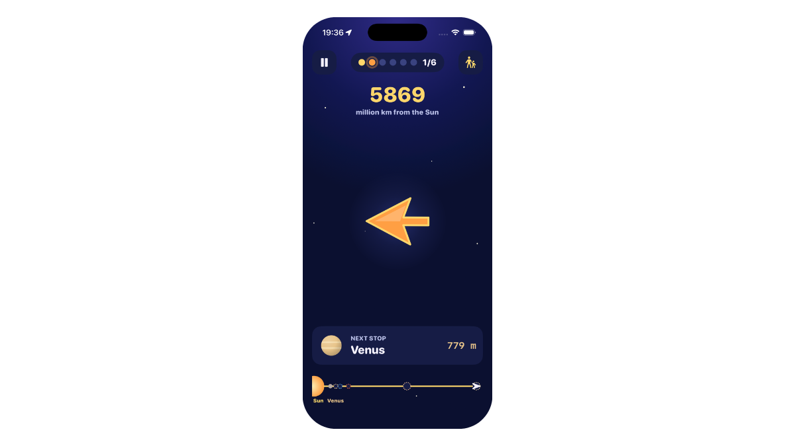

# Software engineer with a soft spot for space.

### Featured projects

<table>
  <tr>
    <td width="50%" valign="top">
      
       <b><a href="LINK-PC-BENCHMARK">Conjunction Pc Benchmark</a></b>
       Comparing satellite collision probability methods on real ESA conjunction data
       Python · Next.js · SQLite
    </td>
    <td width="50%" valign="top">
      
       <b><a href="LINK-SATSAFE">SatSafe</a></b>
       Space situational awareness platform with conjunction screening and game integration
       ASP.NET Core · Vue · modular monolith
    </td>
  </tr>
  <tr>
    <td width="50%" valign="top">
      
       <b><a href="LINK-SPACE-CLEANUP">Space Cleanup</a></b>
       iPad game about clearing space debris
       Swift · SwiftUI · iPadOS
    </td>
    <td width="50%" valign="top">
      
       <b><a href="LINK-SPACE-CADETS">Space Cadets</a></b>
       iOS game that turns any park into a space mission for kids
       Swift · SwiftUI · MapKit
    </td>
  </tr>
  <tr>
    <td width="50%" valign="top">
      
       <b><a href="LINK-CLIMBING">Climbing Log</a></b>
       Climbing logbook for iPhone and Apple Watch <i>(in development)</i>
       Swift · SwiftUI · watchOS
    </td>
    <td width="50%" valign="top">
      
       <b><a href="LINK-NEXUS">Nexus N3 Sensor Emulator</a></b>
       Emulated sensors behind a fake BLE gateway for testing astronaut sensor infrastructure without hardware
       Python · BLE · open source
    </td>
  </tr>
</table>

### Tech

**Languages:** Python · TypeScript/JavaScript · C# · Java · PHP · Swift · SQL

**Frameworks:** ASP.NET Core · React · Next.js · Vue · SwiftUI

**Tools:** Git · Docker · SQLite · NumPy/SciPy

### Learning projects
[Course and practice projects →](https://github.com/jevaali?tab=repositories&q=topic:learning-project)

[LinkedIn](link)

