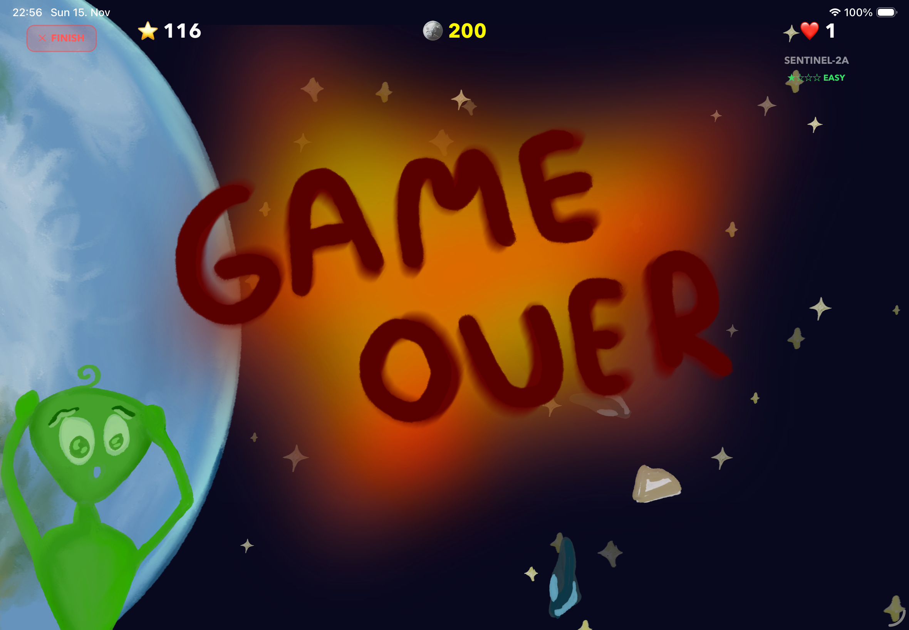

# Software engineer with a soft spot for space.

### Featured projects

<table>
  <tr>
    <td width="50%" valign="top">
      
       <b><a href="LINK-SATSAFE">SatSafe</a></b>
       Space situational awareness platform: fleet overview, orbit visualisation, conjunction screening and alerts for satellite operators
       ASP.NET Core · PostgreSQL · Vue · TypeScript
    </td>
    <td width="50%" valign="top">
      
       <b><a href="LINK-SPACE-CLEANUP">Space Cleanup</a></b>
       Educational iPad game about clearing space debris, featuring real satellites and mission facts
       Swift · SwiftUI · iPadOS
    </td>
  </tr>
</table>

### Currently working on

<table>
  <tr>
    <td width="50%" valign="top">
      
       <b>Space Cadets</b>
       Turning any park into a space mission for kids
       Swift · SwiftUI · MapKit
    </td>
    <td width="50%" valign="top">
      
       <b>Ascent</b>
       A climbing logbook for iPhone and Apple Watch
       Swift · SwiftUI · watchOS
    </td>
  </tr>
</table>

Also in progress: my bachelor's thesis, a platform where researchers can plug in and compare satellite collision probability methods on real ESA conjunction data (Python · Next.js).

### Tech

**Languages:** Python · TypeScript/JavaScript · C# · Java · Swift · SQL

**Frameworks:** ASP.NET Core · Vue · React · Next.js · SwiftUI

**Tools:** Git · Docker · PostgreSQL · NumPy/SciPy
