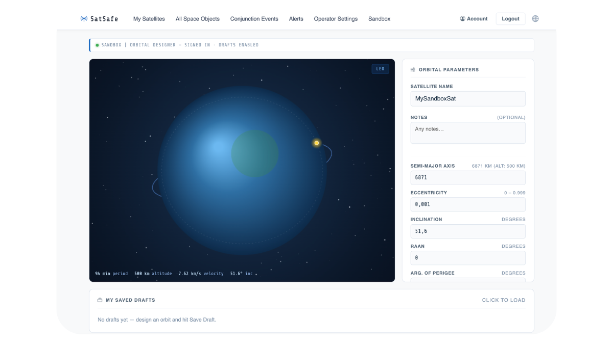
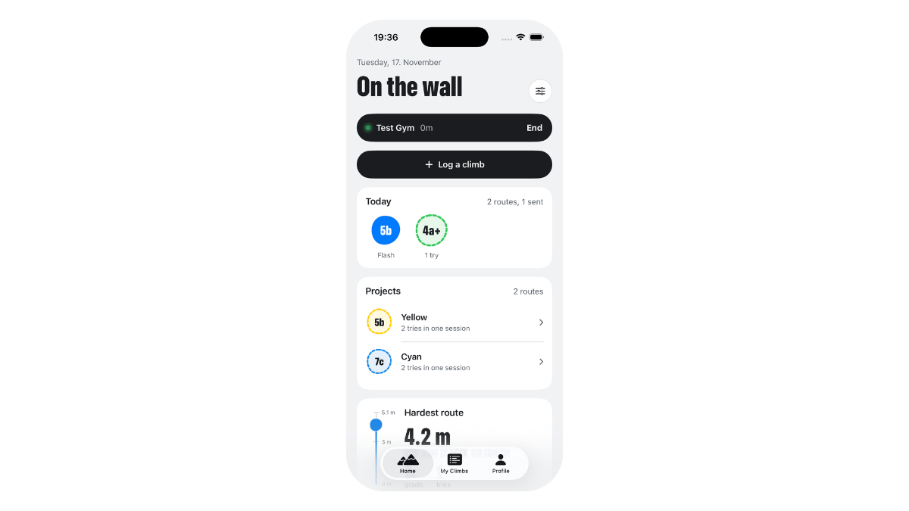

# Software engineer with a soft spot for space.

### Featured projects

<table>
<tr>
<td width="50%" valign="top">

 <b><a href="LINK-TO-REPO">Conjunction Pc Benchmark</a></b>
 Comparing satellite collision probability methods on real ESA conjunction data
 Python · Next.js · SQLite
</td>
<td width="50%" valign="top">

 <b><a href="LINK-TO-REPO">SatSafe</a></b>
 Space situational awareness platform with conjunction screening and game integration
 ASP.NET Core · Vue · modular monolith
</td>
</tr>
<tr>
<td width="50%" valign="top">

 <b><a href="LINK-TO-REPO">Space Cadets</a></b>
 iOS game that turns any park into a space mission for kids
 Swift · SwiftUI · MapKit
</td>
<td width="50%" valign="top">

 <b><a href="LINK-TO-REPO">Climbing Log</a></b>
 Climbing logbook for iPhone and Apple Watch <i>(in development)</i>
 Swift · SwiftUI · watchOS
</td>
</tr>
</table>

**[Nexus N3 Sensor Emulator](LINK-TO-REPO)** – emulated sensors behind a fake BLE gateway for testing astronaut sensor infrastructure without hardware · Python · open source

### Tech
Python · JavaScript/TypeScript · React · Next.js · Vue · C#/.NET · Swift/SwiftUI · Java · SQL

### Learning projects
[Course and practice projects →](https://github.com/jevaali?tab=repositories&q=topic:learning-project)

[LinkedIn](link)

